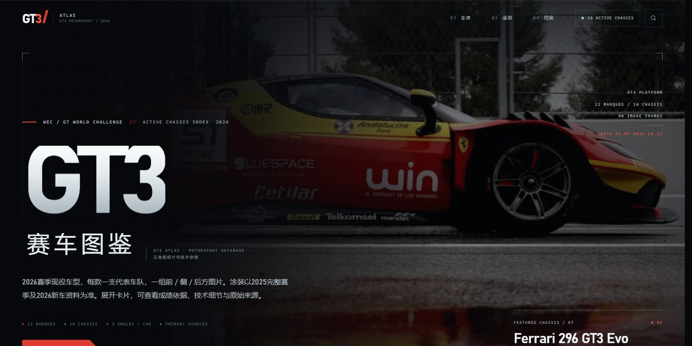

<div align="center">
  <a href="https://agamma233.github.io/gt3-atlas/">
    
  </a>
</div>

# GT3 ATLAS

**2026 GT3 赛车图鉴 / A source-led GT3 chassis archive.**

12 个品牌 · 16 款现役车型 · 48 张三角度实拍 · 36 条资料来源

[**在线访问 LIVE SITE**](https://agamma233.github.io/gt3-atlas/) ·
[双车对比示例](https://agamma233.github.io/gt3-atlas/?compare=bmw%2Cferrari26) ·
[数据纠错](https://github.com/agamma233/gt3-atlas/issues/new?template=data-correction.yml)


> 非官方独立项目。与 FIA、SRO、WEC、GT World Challenge、IMSA、任何车队或制造商均无隶属关系。
> Unofficial fan-made archive. Not affiliated with any series, team or manufacturer.

---

## Why GT3 ATLAS

GT3 ATLAS 不是泛泛的“跑车壁纸库”，而是一份围绕 GT3 赛事语境建立的车型档案：

- **有版本意识**：区分基础车型、Evo 套件、涂装年份与 2026 现役核查结果。
- **有赛事口径**：按 WEC / LMGT3、GTWC Europe、GTWC Asia、GTWC Australia 标注成绩来源。
- **有工程字段**：发动机、功率口径、扭矩、布局、重量、变速箱、底盘、制动、空气动力等参数完整保留。
- **有来源链**：每款车附带直接来源，每个参数保留原始单位与核查注记。
- **不伪造数据**：缺失字段明确标注“未列明 / NOT PUBLISHED”，不做臆测补全，不混用 hp / PS / kW，不把 BoP 数值等同于车辆绝对性能。

## Features

| | |
|---|---|
| **三角度实拍** | 每款车完整保留 FRONT / SIDE / REAR 三张照片；切换角度时同步更新图注、尺寸、车队、原图与出处。 |
| **搜索与筛选** | 实时关键词搜索，品牌、涂装年份、赛事口径筛选，带结果计数与专业空状态。 |
| **双车对比** | 任选两台 GT3 并排对照原始技术字段与来源；不设综合评分，不做“谁更强”的自动判断。 |
| **遥测面板** | 发动机、功率、布局、排量与重量参考的工程化读数，附数据区间说明。 |
| **完整技术档案** | 每款车可展开全部技术字段、核查注记与原始来源链接。 |
| **影像灯箱** | 暗色沉浸式查看器，支持键盘方向键、ESC、触控滑动、原图/出处/下载。 |
| **可分享对比 URL** | `?compare=bmw,ferrari26` 可直接打开指定双车对比。 |
| **响应式与可访问性** | 桌面 / 平板 / 手机布局；键盘操作、焦点管理、`prefers-reduced-motion` 支持。 |
| **单文件离线** | 在线版按需加载图片；可用构建脚本另行导出图片内嵌的离线单文件。 |

## Screenshots

### Garage / 车辆车库


### Head-to-head / 双车对比


## Data coverage

| Field | Count |
|---|---:|
| Marques | 12 |
| Cars / evolutions | 16 |
| Three-angle photographs | 48 |
| Source references | 36 |
| Last verified | 2026-10-21 |

赛事口径分布：GTWC Europe 11 款、WEC / LMGT3 2 款、GTWC Australia 2 款、GTWC Asia 1 款（按现有成绩注记的赛事口径统计）。

## Data integrity

- 图片、成绩、参数与来源均来自现有原始资料，未替换、未虚构。
- 参数按来源原单位保留；不自行换算成统一“排名数值”。
- 功率中的 BoP 条件、重量语义（厂家基础值 / 赛事参考）与版本差异均在字段或注记中说明。
- 每张图片保留原始来源链接；使用或再发布前请阅读 [NOTICE.md](NOTICE.md)。

## 维护与发布 / Editing and publishing

不再手动上传 HTML。源文件提交到 `main` 后，GitHub Actions 会检查、构建并发布到 GitHub Pages。

| 修改内容 | 编辑文件 |
|---|---|
| 赛车标题、车队、参数 | `data/cars.json` |
| 页面布局、固定说明 | `src/page.html` |
| 单款车的卡片结构、照片与出处 | `src/cards/<车型ID>.html` |
| 样式 | `assets/style.css` |
| 搜索、筛选、对比等功能 | `assets/app.js` |
| 照片 | `assets/images/` |

`cars.json` 的 `specs` 按顺序保存参数，`label` 是字段名，`value_html` 是原始数值及来源注记（允许可信的 HTML）。`metadata` 保存搜索与遥测读数；更新发动机、排量或重量时也要检查对应搜索词和遥测值。页面首页的精选车型文案和总数是固定内容，在 `src/page.html` 中维护。新增车型还需新增卡片模板、更新索引及 `scripts/check.py` 的收录数量检查。

### 本地预览

需要 Python 3 和 Git，无需安装前端依赖。

```bash
git clone https://github.com/agamma233/gt3-atlas.git
cd gt3-atlas
python3 scripts/build.py
python3 -m http.server 8000 --directory dist
# 浏览器打开 http://localhost:8000
```

每次修改后重新运行构建命令并刷新浏览器。

### 发布修改

先用 `git diff` 检查修改，然后运行：

```bash
sh scripts/publish.sh "Update BMW specifications"
```

脚本执行检查、构建、提交和推送；GitHub Actions 自动发布。首次使用需通过 GitHub Desktop 或 Git 凭据管理器登录，并设置自己的 Git 提交姓名和邮箱。也可直接在 GitHub 网页编辑 JSON/CSS/JS 并提交，自动构建流程相同。

仓库根目录的 `index.html` 是构建时自动更新的兼容入口快照，不是维护源文件；正式发布使用 Actions 生成的 `dist/index.html`。

### 离线单文件导出

```bash
python3 scripts/build.py --offline
# 输出 dist/gt3-atlas-offline.html，可独立保存和打开
```

### 发布设置

GitHub 仓库 Settings → Pages → Source 设为 **GitHub Actions**。发布结果在 Actions 的 “Build and deploy atlas” 中查看。

## Corrections

Found a wrong chassis year, entry, specification or source link? Please use the **[Data Correction form](https://github.com/agamma233/gt3-atlas/issues/new?template=data-correction.yml)** and include:

1. The car / chassis and field concerned；
2. The current content；
3. The proposed correction；
4. A primary or official source URL；
5. Any BoP / version / unit context needed.

没有来源的性能数字不会被加入图鉴。

## Credits & rights

- 赛车照片、车队涂装、赛事与厂商名称、商标归各自权利人所有。图片以资料索引方式引用，页面内保留原始出处链接；本仓库未获得这些图片的再许可权。
- 技术参数与赛事资料整理自各汽车制造商、赛事官方报名表、积分榜及公开一手文件；具体链接见页面中的车型来源与“全部资料来源”。
- 本项目代码使用 MIT License；第三方图片与标志**不包含**在该许可内。详见 [NOTICE.md](NOTICE.md)。

## License

Code: [MIT](LICENSE)。  
Editorial data compilation: 请注明来源与仓库链接。  
All third-party photographs, logos and liveries: 版权归原权利人所有，不随本仓库授权。
