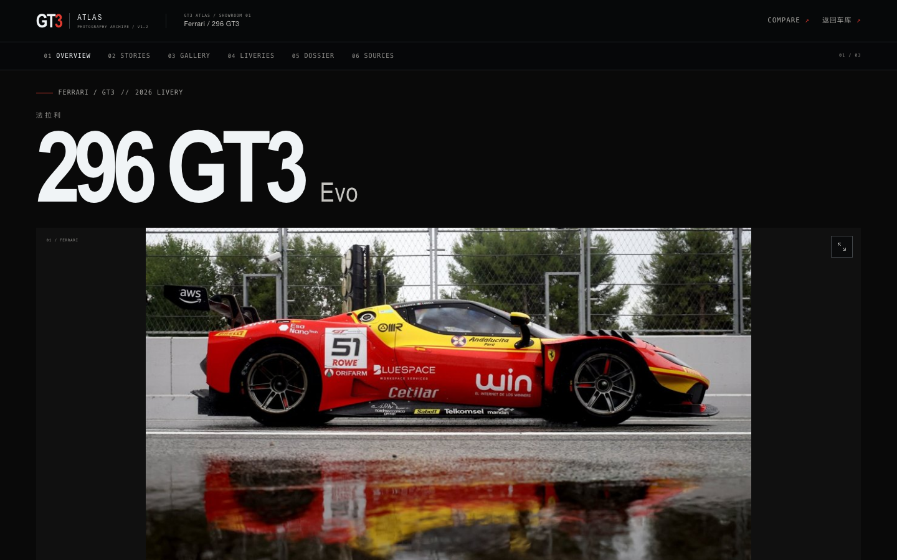
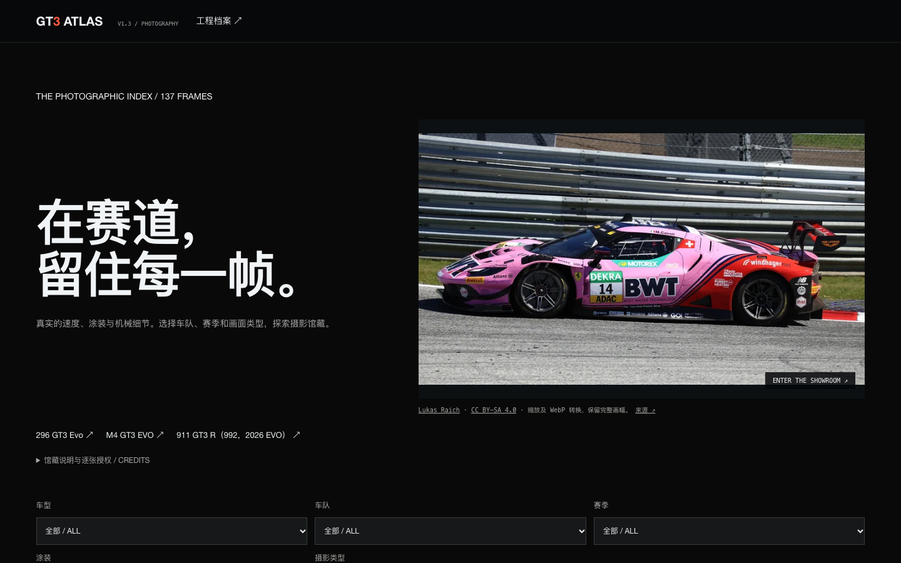
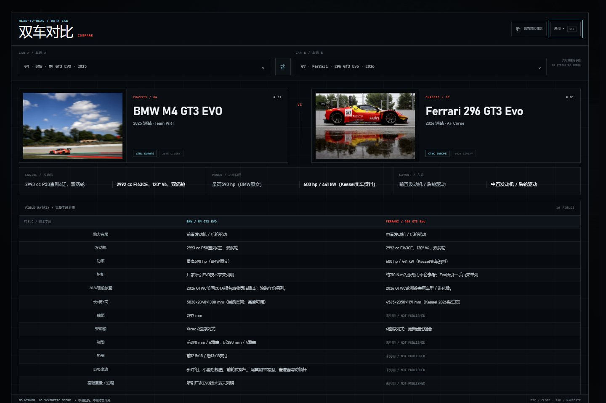

<div align="center">
  <a href="https://agamma233.github.io/gt3-atlas/">
    
  </a>
</div>

# GT3 ATLAS

**GT3 ATLAS V1.3 — MOTORSPORT PHOTOGRAPHY ARCHIVE**

12 个品牌 · 16 款现役车型 · 137 张真实摄影 · 多摄影集 · 3 个独立数字展厅

[**在线访问 LIVE SITE**](https://agamma233.github.io/gt3-atlas/) ·
[双车对比示例](https://agamma233.github.io/gt3-atlas/?compare=bmw%2Cferrari26) ·
[数据纠错](https://github.com/agamma233/gt3-atlas/issues/new?template=data-correction.yml)


> 非官方独立项目。与 FIA、SRO、WEC、GT World Challenge、IMSA、任何车队或制造商均无隶属关系。
> Unofficial archive. Not affiliated with any series, team or manufacturer.

---

## V1.3 / Licensed Photography Expansion

新增 89 张经过车型、来源、许可与视觉核查的 Commons 摄影，共 137 张。Ferrari 296 GT3 Evo 17 张、BMW M4 GT3 EVO 25 张、Porsche 992 2026 更新版 18 张。新增素材覆盖 9 款车型。未使用分类错标、主体车型不同的群车照或重复事故序列补足 150 张目标；本轮未找到足够合格的夜赛和维修区素材。

全站 [摄影馆藏](https://agamma233.github.io/gt3-atlas/photography/) 与独立展厅均支持按车队、赛季、涂装和摄影类型筛选；全站馆藏还可按车型筛选，支持 `?car=bmw` 链接。筛选结果控制灯箱浏览范围，并提供空结果提示、重置与键盘操作。新增图片提供 320/800/1600px WebP、响应式 `srcset` 和懒加载。

逐张作者、来源、CC 许可、修改与车型证据：[核查清单](docs/photography-v1.3.md)。原有 48 张图片及技术数据全部保留，其未确认再许可状态并未改变。导入脚本及依赖见 `scripts/photo_import/`，构建和 CI 仍只需 Python 标准库。

## V1.2 / Motorsport Photography Archive

V1.2 将原有三款独立展厅升级为摄影档案馆，保留 16 款车型、48 张原始实拍、工程参数与双车对比。三个页面由同一套 `src/showroom.html` 模板和同一份数据生成，不是三份手写 HTML：

| Showroom | Route | Chassis |
|---|---|---|
| Ferrari 296 GT3 Evo | `/cars/ferrari26/` | 07 |
| BMW M4 GT3 EVO | `/cars/bmw/` | 04 |
| Porsche 911 GT3 R（992 / 2026 EVO） | `/cars/porsche26/` | 15 |

**展厅特性**

- 大幅实拍首屏，`object-fit: contain` 保留完整车身；移动端不裁切主体。
- 摄影档案：杂志式 PHOTO STORIES、可变数量摄影集、主图/缩略图联动、明确加载失败状态。
- PhotoSwipe 全屏灯箱：缩放、拖动、双指捏合、滑动、方向键、ESC、焦点返回与可追溯出处。
- LIVERIES & TEAMS 和摄影资料账本：未核实的摄影师、赛事、赛道、日期保留为空。
- 工程档案：POWERTRAIN / TRANSMISSION / CHASSIS / BRAKING / AERODYNAMICS / DIMENSIONS / REGULATIONS 七类字段。
- 缺失字段明确标为“未列明 / NOT PUBLISHED”；不将综合 Evo 描述拆成未经披露的单项数值。
- 车型关联、来源账本、双车对比 handoff 和返回车库入口。
- 首页入口：顶部导航“数字展厅 / SHOWROOM”、首屏 Ferrari 精选卡直达展厅、移动端 INDEX 三款展厅直达、车库展厅卡与每车 CTA；整张展厅卡均可点击。
- 同一份 `assets/showroom.css` + `assets/showroom.js`，无框架、无在线字体；唯一新增运行时依赖为本地固定的 PhotoSwipe 5.4.4（MIT），首次打开灯箱才导入。

## Existing garage / 原有能力

主图鉴保留并继续提供：

- 16 款车型、12 个品牌、48 张真实三角度照片。
- 搜索，品牌 / 年份 / 赛事口径筛选。
- 每款车的技术抽屉、原始来源与核查注记。
- 技术遥测面板与选车联动。
- 双车对比，保留 `?compare=bmw,ferrari26` 分享链接。
- 图片灯箱、键盘操作、响应式布局和 reduced-motion 支持。
- 三款试点车型新增独立展厅卡片入口和首页展厅导览。

主站使用外部 CSS、JavaScript 与图片资产；离线构建另生成一份完全自包含的单文件车库。

数据关系与迁移说明：[PHOTOGRAPHY_SCHEMA.md](docs/PHOTOGRAPHY_SCHEMA.md)。依赖、许可证与参考项目评估：[THIRD_PARTY.md](docs/THIRD_PARTY.md)。实测结果：[VERIFICATION.md](docs/VERIFICATION.md)。

## Screenshots

### Ferrari showroom


### Photography homepage



[V1.3 手机摄影馆藏](docs/screenshots/v1.3-archive-390.png) · [手机展厅](docs/screenshots/ferrari26-390.png) · [摄影故事](docs/screenshots/stories-1440.png) · [完整图库](docs/screenshots/gallery-1440.png) · [触控灯箱](docs/screenshots/viewer-touch-390.png)

### Head-to-head



## Project architecture

```text
.
├── data/
│   ├── cars.json              # 16 cars: specs, metadata, HUD values
│   ├── photos.json            # canonical entries, liveries, collections and photo records
│   └── showrooms.json         # 3 showroom configs, field groups, sources, lineage
├── src/
│   ├── page.html              # garage shell
│   ├── cards/<car-id>.html    # per-car garage card template
│   └── showroom.html          # one shared showroom template
├── assets/
│   ├── style.css              # garage design system + showroom entry styles
│   ├── app.js                 # garage search / filter / telemetry / compare / lightbox
│   ├── showroom.css           # standalone showroom presentation layer
│   ├── showroom.js            # gallery, lightbox, scroll spy, compare handoff
│   └── images/                # original 48 photographs, content-addressed names
├── scripts/
│   ├── build.py               # garage + showroom build, --offline mode
│   ├── showroom_builder.py    # shared template renderer for the 3 routes
│   └── check.py               # data, hash, route, asset and offline checks
├── tests/browser/
│   ├── showroom_navigation.mjs # dependency-free Chrome/CDP navigation regression
│   └── photo_archive.mjs       # viewer, touch, layout and garage regression
├── .github/workflows/pages.yml
├── index.html                 # generated compatibility snapshot; build output in dist/
└── dist/                      # generated web build; not committed
```

`data/cars.json` remains the technical source for the garage. `data/photos.json` is the canonical photography inventory and relation graph, migrated from the existing 48 card images. Legacy team/year snapshots remain for compatibility; archive metadata resolves entries and liveries. `data/showrooms.json` adds only presentation grouping and verified relationships; it does not invent technical values.

## Build and preview

```bash
python3 scripts/build.py
python3 scripts/build.py --offline
python3 scripts/check.py
python3 -m unittest discover -s tests -v

# Chrome installed locally; test serves dist/ at /gt3-atlas/
node tests/browser/showroom_navigation.mjs
node tests/browser/photo_archive.mjs

python3 -m http.server 8000 --directory dist
# http://127.0.0.1:8000/
# http://127.0.0.1:8000/cars/ferrari26/
# http://127.0.0.1:8000/cars/bmw/
# http://127.0.0.1:8000/cars/porsche26/
```

On Windows, use `python` where `python3` is unavailable. The browser test needs Node.js 22+ and Chrome/Chromium; set `CHROME_PATH` if the browser is installed in a non-standard location.

### Outputs

```text
dist/index.html
dist/cars/ferrari26/index.html
dist/cars/bmw/index.html
dist/cars/porsche26/index.html
dist/gt3-atlas-offline.html
dist/assets/...
dist/sitemap.xml
```

All internal links are relative, so the build works at the GitHub Pages project path `/gt3-atlas/`. Canonical and social URLs use the absolute production origin.

### Offline boundary

`dist/gt3-atlas-offline.html` is self-contained: the 48 images are Base64, CSS and JavaScript are inline, and the page works without a server. The independent showroom routes are **not** embedded in that one file; they require the `dist/` tree or the deployed site. Showroom rail and card links are omitted from the offline page rather than leaving dead links.

## Adding another showroom

1. Ensure the vehicle exists in `data/cars.json` and has card markup under `src/cards/`.
2. Add at least one verified photo and its entry/livery/collection relations in `data/photos.json`; see the photography schema document.
3. Add a config in `data/showrooms.json`:
   - `hero_photo` (must belong to the same car),
   - `headline_fields`,
   - exact `field_groups` covering every spec label once,
   - source links, verified `lineage`, compare default and accent,
   - add the ID to `featured`.
4. Add `{{showroom-link}}` to the card’s `.v-actions`; the shared builder renders its rail entry, mobile INDEX link and (for `featured[0]`) the hero card.
5. Run:
   ```bash
   python3 scripts/build.py
   python3 scripts/build.py --offline
   python3 scripts/check.py
   ```

Never copy a complete showroom page; add data and rebuild.

## Data integrity

- All 48 images are the original archive files; `scripts/check.py` verifies their SHA-256 against `data/photos.json`.
- No AI-generated images and no new external racing photography are introduced by this build.
- Technical values remain exactly as published, with units, BoP conditions and version notes retained.
- `AERODYNAMICS` and other empty categories are shown explicitly as empty when the archive does not publish independent values. Missing values are not zero and are not filled speculatively.
- Each showroom has a source ledger; each photo has original and gallery-source links. Rights remain with the original holders. See [NOTICE.md](NOTICE.md).

## Tests / quality checks

`python3 scripts/check.py` validates, among other things:

- 16 unique vehicles and at least the original 48 unique photo records;
- original 48 keys/paths/hashes remain unchanged; arbitrary positive frame counts and valid entry/livery/collection ownership;
- photo files exist and match their SHA-256;
- showroom field groups cover every spec exactly once;
- hero photo ownership and compare defaults are valid;
- generated garage keeps 16 cards, three showroom previews and three card links;
- the hero Ferrari card opens `cars/ferrari26/` rather than `#ferrari26`;
- the desktop nav exposes 数字展厅 / SHOWROOM and the mobile INDEX has all three direct showroom routes;
- every hero, rail, dossier and mobile entry resolves to the correct `/gt3-atlas/cars/<id>/` URL;
- showroom cards are full-card links and are not disabled by `pointer-events: none`;
- each showroom has 7 categories, matching gallery/ledger counts, all specs, sources and a garage return;
- related cards are single, valid anchors rather than nested links;
- no unresolved template tokens or duplicate showroom IDs;
- local HTML resources resolve, with no root-absolute assets;
- sitemap includes all showroom routes;
- the offline archive has 16 cards, 48 embedded images and no external dependencies or dead showroom links.

Both browser suites launch real installed Chrome through CDP with no npm dependencies or browser download. Navigation regression covers entry clicks, hit-testing and history; the photography suite tests all four required viewports (1440×900, 1024×768, 390×844, 375×812), zoom/pan, keyboard, pinch/swipe, collection switching, search/filters/telemetry, legacy compare links, offline output, reduced motion, script-disabled rendering and image failures. See [the recorded results](docs/VERIFICATION.md) for actual timings and limits; no Lighthouse score is claimed.

## Deployment

GitHub Actions builds and deploys `dist/` from `main`. Pull requests run build, static checks and the Chrome navigation regression against `/gt3-atlas/`; they never deploy. The repository’s Pages source is already configured for GitHub Actions.

Known V1.2 limits:

- Only the three requested pilot showrooms are generated; the other 13 cars keep their existing garage dossiers.
- Some categories are empty for specific cars because the source archive does not publish independent values; they are intentionally visible as empty.
- The generated `index.html` compatibility snapshot is overwritten by the build; edit `src/page.html` and `src/cards/`, not the generated file.
- Existing previews are preserved at their local resolution (typically 1000 px wide); the original source image is available through an explicit link. The viewer does not automatically fetch remote high-resolution originals.
- The original garage keeps three curated angles per car. Additional archive frames do not automatically become garage angle slots.
- Original 48 images retain unconfirmed republication status. New Commons images have individually recorded Creative Commons grants; source-provided capture facts remain distinguished from engineering data.
- Mobile checks emulate Chrome touch input. No claim is made about a physical iPhone/Safari test.

## Credits, corrections & licence

- Race photography and liveries: original rights holders, with source links retained per image.
- Technical data: manufacturer releases, official entry lists, standings and public technical documents linked in the archive.
- Code: MIT. Third-party photography and marks are excluded from that licence; see [NOTICE.md](NOTICE.md).
- Corrections with a primary source are welcome via the [Data Correction form](https://github.com/agamma233/gt3-atlas/issues/new?template=data-correction.yml).

**GT3 ATLAS / 2026** · DATA AS OF 2026.10.21 · 16 CHASSIS / 137 FRAMES / 36 REFERENCES
