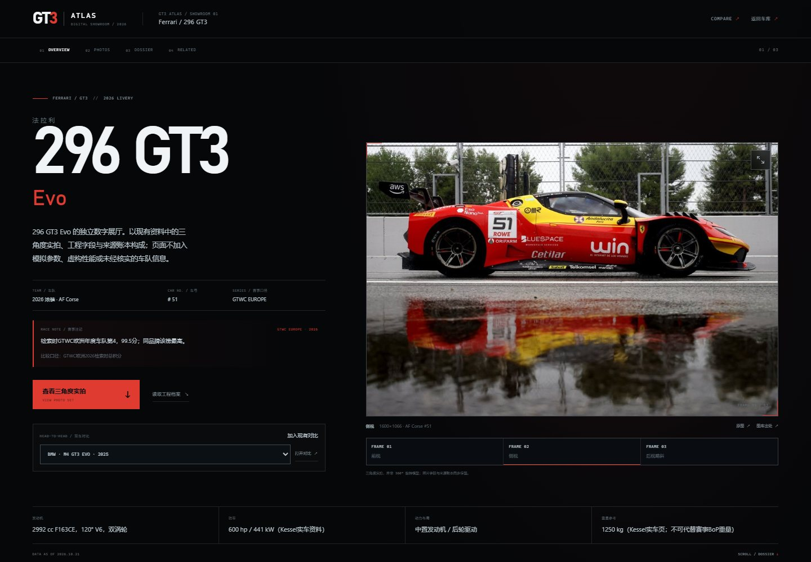
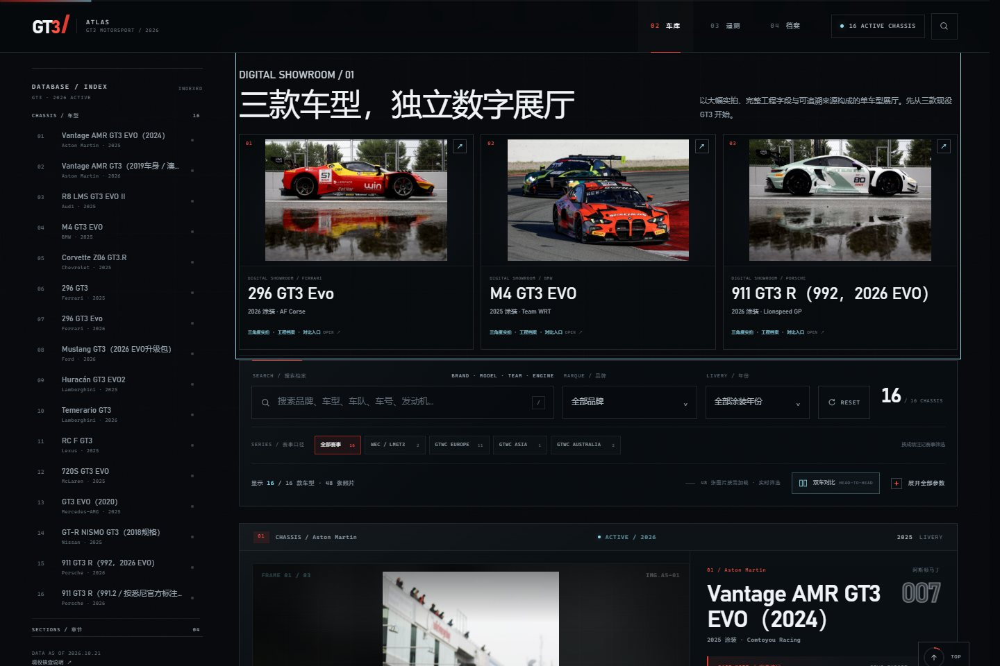

<div align="center">
  <a href="https://agamma233.github.io/gt3-atlas/">
    
  </a>
</div>

# GT3 ATLAS

**2026 GT3 赛车图鉴 / Digital Showroom V1.1**

12 个品牌 · 16 款现役车型 · 48 张三角度实拍 · 3 个独立数字展厅

[**在线访问 LIVE SITE**](https://agamma233.github.io/gt3-atlas/) ·
[双车对比示例](https://agamma233.github.io/gt3-atlas/?compare=bmw%2Cferrari26) ·
[数据纠错](https://github.com/agamma233/gt3-atlas/issues/new?template=data-correction.yml)


> 非官方独立项目。与 FIA、SRO、WEC、GT World Challenge、IMSA、任何车队或制造商均无隶属关系。
> Unofficial archive. Not affiliated with any series, team or manufacturer.

---

## V1.1 / Digital Showroom

V1.1 在原有 16 款车库之上增加三款车型的独立数字展厅。三个页面由同一套 `src/showroom.html` 模板和同一份数据生成，不是三份手写 HTML：

| Showroom | Route | Chassis |
|---|---|---|
| Ferrari 296 GT3 Evo | `/cars/ferrari26/` | 07 |
| BMW M4 GT3 EVO | `/cars/bmw/` | 04 |
| Porsche 911 GT3 R（992 / 2026 EVO） | `/cars/porsche26/` | 15 |

**展厅特性**

- 大幅实拍首屏，`object-fit: contain` 保留完整车身；移动端不裁切主体。
- 摄影档案：画廊切换、加载/失败状态、全屏灯箱、方向键、ESC、触控滑动、原图与图库出处。
- 工程档案：POWERTRAIN / TRANSMISSION / CHASSIS / BRAKING / AERODYNAMICS / DIMENSIONS / REGULATIONS 七类字段。
- 缺失字段明确标为“未列明 / NOT PUBLISHED”；不将综合 Evo 描述拆成未经披露的单项数值。
- 车型关联、来源账本、双车对比 handoff 和返回车库入口。
- 同一份 `assets/showroom.css` + `assets/showroom.js`，无框架、无在线字体、无第三方运行时依赖。

## Existing garage / 原有能力

主图鉴保留并继续提供：

- 16 款车型、12 个品牌、48 张真实三角度照片。
- 搜索，品牌 / 年份 / 赛事口径筛选。
- 每款车的技术抽屉、原始来源与核查注记。
- 技术遥测面板与选车联动。
- 双车对比，保留 `?compare=bmw,ferrari26` 分享链接。
- 图片灯箱、键盘操作、响应式布局和 reduced-motion 支持。
- 三款试点车型新增独立展厅卡片入口和首页展厅导览。

主站使用外部 CSS、JavaScript 与图片资产；离线构建另生成一份完全自包含的单文件车库。

## Screenshots

### Ferrari showroom


### Garage / showroom entry



### Head-to-head


## Project architecture

```text
.
├── data/
│   ├── cars.json              # 16 cars: specs, metadata, HUD values
│   ├── photos.json            # 48 photo records: angle, credit, source, team, SHAs
│   └── showrooms.json         # 3 showroom configs, field groups, sources, lineage
├── src/
│   ├── page.html              # garage shell
│   ├── cards/<car-id>.html    # per-car garage card template
│   └── showroom.html          # one shared showroom template
├── assets/
│   ├── style.css              # garage design system + showroom entry styles
│   ├── app.js                 # garage search / filter / telemetry / compare / lightbox
│   ├── showroom.css           # standalone showroom presentation layer
│   ├── showroom.js            # gallery, lightbox, scroll spy, compare handoff
│   └── images/                # original 48 photographs, content-addressed names
├── scripts/
│   ├── build.py               # garage + showroom build, --offline mode
│   ├── showroom_builder.py    # shared template renderer for the 3 routes
│   └── check.py               # data, hash, route, asset and offline checks
├── .github/workflows/pages.yml
├── index.html                 # generated compatibility snapshot; build output in dist/
└── dist/                      # generated web build; not committed
```

`data/cars.json` remains the technical source for the garage. `data/photos.json` is a canonical inventory generated from the existing 48 card images, including their original/source links, credits, team and livery year. `data/showrooms.json` adds only presentation grouping and verified relationships; it does not invent technical values.

## Build and preview

```bash
python3 scripts/build.py
python3 scripts/build.py --offline
python3 scripts/check.py

python3 -m http.server 8000 --directory dist
# http://127.0.0.1:8000/
# http://127.0.0.1:8000/cars/ferrari26/
# http://127.0.0.1:8000/cars/bmw/
# http://127.0.0.1:8000/cars/porsche26/
```

On Windows, use `python` where `python3` is unavailable.

### Outputs

```text
dist/index.html
dist/cars/ferrari26/index.html
dist/cars/bmw/index.html
dist/cars/porsche26/index.html
dist/gt3-atlas-offline.html
dist/assets/...
dist/sitemap.xml
```

All internal links are relative, so the build works at the GitHub Pages project path `/gt3-atlas/`. Canonical and social URLs use the absolute production origin.

### Offline boundary

`dist/gt3-atlas-offline.html` is self-contained: the 48 images are Base64, CSS and JavaScript are inline, and the page works without a server. The independent showroom routes are **not** embedded in that one file; they require the `dist/` tree or the deployed site. Showroom rail and card links are omitted from the offline page rather than leaving dead links.

## Adding another showroom

1. Ensure the vehicle exists in `data/cars.json` and has card markup under `src/cards/`.
2. Ensure its three photo records exist in `data/photos.json` (the current data was extracted from the card templates).
3. Add a config in `data/showrooms.json`:
   - `hero_photo` (must belong to the same car),
   - `headline_fields`,
   - exact `field_groups` covering every spec label once,
   - source links, verified `lineage`, compare default and accent,
   - add the ID to `featured`.
4. Add `{{showroom-link}}` to the card’s `.v-actions`; the shared builder renders its rail entry.
5. Run:
   ```bash
   python3 scripts/build.py
   python3 scripts/build.py --offline
   python3 scripts/check.py
   ```

Never copy a complete showroom page; add data and rebuild.

## Data integrity

- All 48 images are the original archive files; `scripts/check.py` verifies their SHA-256 against `data/photos.json`.
- No AI-generated images and no new external racing photography are introduced by this build.
- Technical values remain exactly as published, with units, BoP conditions and version notes retained.
- `AERODYNAMICS` and other empty categories are shown explicitly as empty when the archive does not publish independent values. Missing values are not zero and are not filled speculatively.
- Each showroom has a source ledger; each photo has original and gallery-source links. Rights remain with the original holders. See [NOTICE.md](NOTICE.md).

## Tests / quality checks

`python3 scripts/check.py` validates, among other things:

- 16 unique vehicles and 48 unique photo records;
- each car has three photos, and photo team / livery year match the car;
- photo files exist and match their SHA-256;
- showroom field groups cover every spec exactly once;
- hero photo ownership and compare defaults are valid;
- generated garage keeps 16 cards, three showroom previews and three card links;
- each showroom has 7 categories, matching gallery/ledger counts, all specs, sources and a garage return;
- no unresolved template tokens or duplicate showroom IDs;
- local HTML resources resolve, with no root-absolute assets;
- sitemap includes all showroom routes;
- the offline archive has 16 cards, 48 embedded images and no external dependencies or dead showroom links.

Browser interaction tests were run against the generated build at 1440 × 1000, 1024 × 768, 390 × 844 and 375 × 812 px. Gallery switching, lightbox keyboard close, compare handoff, filters, telemetry and existing compare URLs were exercised. No horizontal overflow was observed at those widths. Lighthouse was not available as a reproducible local check; no Lighthouse score is claimed. Local PerformanceObserver samples recorded CLS 0; exact LCP varies by host and network.

## Deployment

GitHub Actions builds and deploys `dist/` from `main`. Pull requests run only build + checks, never deploy. The repository’s Pages source is already configured for GitHub Actions.

Known V1.1 limits:

- Only the three requested pilot showrooms are generated; the other 13 cars keep their existing garage dossiers.
- Some categories are empty for specific cars because the source archive does not publish independent values; they are intentionally visible as empty.
- The generated `index.html` compatibility snapshot is overwritten by the build; edit `src/page.html` and `src/cards/`, not the generated file.
- `data/photos.json` was bootstrapped from the existing card photo markup; future photo edits should update both the card and, only if needed, the canonical JSON record.

## Credits, corrections & licence

- Race photography and liveries: original rights holders, with source links retained per image.
- Technical data: manufacturer releases, official entry lists, standings and public technical documents linked in the archive.
- Code: MIT. Third-party photography and marks are excluded from that licence; see [NOTICE.md](NOTICE.md).
- Corrections with a primary source are welcome via the [Data Correction form](https://github.com/agamma233/gt3-atlas/issues/new?template=data-correction.yml).

**GT3 ATLAS / 2026** · DATA AS OF 2026.10.21 · 16 CHASSIS / 48 FRAMES / 36 REFERENCES
